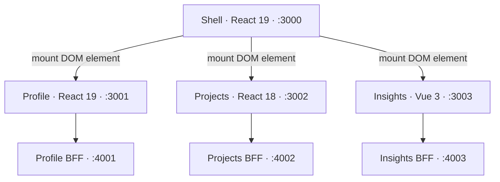

# Runtime boundaries



The Rspack enhanced Module Federation plugin emits a manifest for every remote. Shell registers configured manifest URLs at runtime and loads only the sections needed for the current route. The homepage loads all three independently.

## Contract

```ts
mount(element, {
  route: '/', // relative to the slice
  mode: 'summary', // or "full"
  navigate: (path) => {}, // full site path
  onStatus: (metadata) => {}, // optional diagnostics
}); // => { unmount() }
```

Only a DOM element, strings, callbacks, and plain metadata cross the boundary. React elements, hooks, providers, and contexts remain inside their owning rendering root. Standalone bootstrap imports the same exposed mount module used by federation.

Shell and Profile negotiate React, React DOM, React DOM client, and JSX runtimes in the `default` federation scope. Projects declares these dependencies in `react18`, and shell registers that remote with the matching scope. Exact consumer aliases resolve shared UI source against each application’s own package installation. The UI library is not a cross-version federation singleton.

The exported `metadata.version` and rendered `data-version` attributes use the framework’s actual imported `version` export. They are not labels copied from a package manifest. This is what the browser tests assert.

## Lifecycles and failure recovery

Each mount owns its rendering root, keeps it in a WeakMap, and returns an idempotent unmount operation. Remounting the same container first disposes its existing root.

React data effects and Vue watchers each own an AbortController. Navigation, filter changes, retries, and unmount abort prior requests. A late response cannot update an inactive root. Request timeouts produce local retry states.

The shell owns history, popstate handling, scroll reset, and main-content focus after navigation. Modified link clicks retain normal browser behavior. Cleanup of nested React roots is deferred to a microtask after shell’s commit so that one React root is not synchronously torn down inside another root’s render work.

Federation loading has an activity guard and a deadline. Runtime-managed script downloads can finish after navigation, but they cannot mount into a stale container. A retry force-registers the remote to clear failed runtime loading state. The deadline bounds the loading UI; it does not claim to cancel federation’s underlying shared script transport.

A missing remote, a failed BFF, invalid fixture data, and an unknown detail route all have local recovery UI. No slice reads another slice’s API.

## Styling and static serving

Tailwind 4 runs through PostCSS in Rspack. Shared theme and utilities are included in each slice’s own CSS module. Custom selectors are scoped under `.eh-profile`, `.eh-projects`, or `.eh-insights`. The shared `eh-` primitives use one consistent token vocabulary.

Only shell and standalone entrypoints import the common reset. Federated mount modules do not import a second preflight. CSS is injected by the owning JavaScript bundle, so loading a remote loads its required styles.

HTML entry scripts use root-relative paths so deep links refresh correctly. Remote assets use automatic public paths resolved from their remote entry origin. Both development and static preview servers support SPA fallbacks and cross-origin remote assets. Static previews return 404 for missing assets instead of returning HTML as JavaScript.

The preview runner serves production frontend files but uses the same read-only TypeScript fixture BFF processes. It is a local verification environment, not a deployment implementation.
