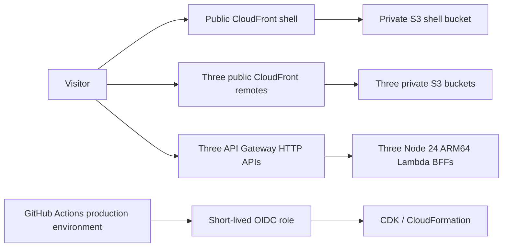

# AWS deployment

The repository includes deployable CDK infrastructure and a GitHub Actions pipeline. Nothing is deployed merely by running tests or `infra:synth`. The production job stays disabled until `AWS_DEPLOY_ENABLED=true` is configured. No AWS account, credentials, or public CloudFront URL are assumed to exist yet.

## Public hosting and boundaries



Each frontend gets its own `https://<distribution>.cloudfront.net` address. The shell URL is the portfolio's public entry point; the other URLs also support standalone browsing. S3 has no public ACL, public policy, or website endpoint. CloudFront uses Origin Access Control, redirects HTTP to HTTPS, and adds security headers. The default CloudFront certificate uses AWS's fixed default security policy; setting a minimum TLS policy requires a custom domain and ACM certificate, which are not provisioned here.

An extensionless route is rewritten to `index.html` by a tested CloudFront Function. Missing JavaScript/JSON assets remain errors. Runtime configuration points each remote at its own HTTP API. Express runs through an HTTP API v2 Lambda adapter, so local and deployed APIs share business rules and contracts. CORS allows the shell and owning remote; it is not authentication. These read-only portfolio APIs are intentionally public.

There is no VPC, NAT gateway, load balancer, database, provisioned concurrency, custom domain, WAF subscription, or paid monitoring dashboard. Logs expire after seven days. Functions use 256 MB, ARM64, and a ten-second timeout. Each API is throttled to two requests/second with a burst of five. API throttles and budget emails are not hard spending caps.

## One-time account setup (Windows)

Use a dedicated AWS account or sandbox for this portfolio. Install AWS CLI v2, authenticate with an administrative SSO profile, and verify the account. The setup below creates resources and is intentionally separate from local validation.

```powershell
aws sso login --profile portfolio
$env:AWS_PROFILE = 'portfolio'
npm ci
.\scripts\bootstrap.ps1 -AccountId 'YOUR_12_DIGIT_ACCOUNT_ID' -Region 'us-east-1'
```

If the account already has GitHub's OIDC provider, also pass `-ExistingProviderArn 'arn:aws:iam::ACCOUNT:oidc-provider/token.actions.githubusercontent.com'`. An account should have only one provider for that issuer. Reuse the same context value whenever deliberately deploying the identity stack.

The script checks your account, creates the reviewed execution policy, bootstraps CDK with that policy instead of `AdministratorAccess`, and deploys `EvanHyerIdentity`. It is a first-time script: if the policy or bootstrap already exists, inspect and reuse/update it explicitly rather than creating another. Policy template: [bootstrap-execution-policy.json](../infra/bootstrap-execution-policy.json). For other terminals, substitute the account/region placeholders in that JSON, create the managed IAM policy with AWS CLI, then run `npx cdk bootstrap aws://ACCOUNT/REGION --cloudformation-execution-policies POLICY_ARN` and `npx cdk deploy EvanHyerIdentity`.

The CloudFormation execution policy limits S3, Lambda, logs, and IAM roles to this project's names. CloudFront creation and regional API control need broader control-plane permissions. A trusted deployment can modify project IAM policies; this is not a security boundary against malicious repository administrators. Protect the repository and bootstrap credentials. The GitHub role can assume only the account/region's CDK deployment, file-publishing, and lookup roles; publication permissions are limited to the four resulting buckets/distributions. Runtime roles can write only their own logs.

## GitHub configuration

Create the `production` environment and restrict deployment branches to **main** before enabling deployment. Use environment protection/review rules if available for your GitHub plan. Require the `verify` job on pull requests, review workflow/infrastructure changes, and disable force pushes to main. GitHub plan support for protected environments and private-repository branch rules varies; check what your account offers.

Set these repository/environment variables (not access-key secrets):

| Variable             | Value                                                                 |
| -------------------- | --------------------------------------------------------------------- |
| `AWS_ACCOUNT_ID`     | Your twelve-digit account ID                                          |
| `AWS_REGION`         | `us-east-1`, or the bootstrapped region                               |
| `BUDGET_EMAIL`       | Address for the account-wide monthly $5 budget alerts                 |
| `AWS_DEPLOY_ENABLED` | Repository variable `true` only after bootstrap and environment setup |

The OIDC trust accepts only `repo:evan-hyer/evan-hyer-site:environment:production` and the STS audience. No long-lived AWS key is stored in GitHub. Restricting the environment to main is essential because the environment subject itself contains no branch. Fork PR jobs cannot obtain the deployment token. Actions are pinned to commit SHAs and Dependabot proposes updates.

Push to main or run **Verify and deploy** manually. CI checks formatting, types, unit coverage, HTTP/Lambda/infrastructure tests, four production builds, CDK synthesis, and browser tests in development and static-preview modes. Deployment only uses the frontend artifact produced by that successful run. It deploys the CDK site stack, writes runtime configuration from CloudFormation outputs, publishes remotes before the shell, waits for invalidations, and smoke-tests public routes, assets, configuration, and API contracts.

The `shellUrl` in the `deployment-<commit>` artifact is the public portfolio URL. All four frontend URLs and the three API URLs are in `cdk-outputs.json`. Do not use the synthetic account `111111111111` from offline tests for a real deployment.

## Releases, rollback, and cleanup

Production remote entries and chunks have content hashes. Hashed assets are uploaded first with a year-long immutable cache policy; configuration, manifests, and HTML require revalidation and are uploaded afterward. Source maps and federation statistics are not published. Existing chunks are retained for open browser sessions; there is no destructive `s3 sync --delete`. S3 versioning retains previous mutable objects for 30 days. Old hashed current objects persist and consume storage: review and remove assets only after the rollback/client retention window, or periodically recreate this disposable portfolio environment with a planned outage.

Deployment concurrency prevents overlapping production writes. Multi-application publication is not a single atomic transaction. Maintain backward-compatible mount and API contracts. If publication or smoke checks fail, the workflow fails and preserves outputs; previous assets are still available. Revert the faulty commit on main and let the complete verification/deployment pipeline redeploy the known-good source. This also restores Lambda/CDK changes where CloudFormation supports rollback; review destructive infrastructure changes separately. Avoid blindly rerunning an older deployment over a newer release.

`npx cdk diff EvanHyerSite -c budgetEmail=YOUR_EMAIL` previews infrastructure changes. `npm run infra:synth` is offline and bundles all three Lambda functions without Docker. Keep stack names and the fixed project prefix stable; this scaffold supports one environment per account/region, not arbitrary parallel staging stacks.

For teardown, disable deployment first, then destroy the site stack and identity stack with an appropriate local AWS role. Buckets are deliberately retained, including versions, and continue to incur storage costs until explicitly emptied and deleted. The CDK bootstrap bucket/roles and execution policy are also retained outside these stacks. An imported shared OIDC provider must not be deleted. Budget notifications disappear with the site stack.

## Free-tier expectations

This design minimizes fixed costs; it does not guarantee a permanently free website. Check your account's eligibility and usage before deployment. AWS's current new-account program offers up to $200 in credits and a free plan lasting at most six months; paid-plan usage beyond credits or allowances is billable. Existing accounts have different eligibility. See the [AWS Free Tier FAQ](https://aws.amazon.com/free/free-tier-faqs/).

The code creates ordinary pay-as-you-go CloudFront distributions; it does **not** enroll them in a CloudFront flat-rate Free plan. Review [CloudFront pricing](https://aws.amazon.com/cloudfront/pricing/), [Lambda pricing](https://aws.amazon.com/lambda/pricing/), [HTTP API pricing](https://aws.amazon.com/api-gateway/pricing/), [S3 pricing](https://aws.amazon.com/s3/pricing/), and CloudWatch usage. Tiny traffic may fit available allowances, but storage, requests, CDN functions, logs, API calls, and abuse can produce charges. The optional CDK budget, required by the supplied deployment workflow, sends account-wide actual-spend alerts at $2.50 and $5; billing data and notifications can lag.

Technical references: [Node 24 Lambda runtime](https://docs.aws.amazon.com/lambda/latest/dg/lambda-nodejs.html), [S3 Origin Access Control in CDK](https://github.com/aws/aws-cdk/blob/main/packages/aws-cdk-lib/aws-cloudfront-origins/README.md), and [GitHub OIDC with AWS](https://docs.github.com/en/actions/how-tos/secure-your-work/security-harden-deployments/oidc-in-aws).
